<p align="center">
  
</p>

<p align="center">
  <a href="https://github.com/huangyu8733/nexmem/actions/workflows/ci.yml"></a>
  <a href="https://github.com/huangyu8733/nexmem/releases/latest"></a>
  
</p>

# Nexmem（奈讯联）

**本地优先、端到端加密的去中心化 P2P 即时通讯系统。** 一套 Go 内核 + Flutter 界面，覆盖 Windows / macOS / Linux / Android / iOS / Web 六端；33 个 locale 布局适配（含阿拉伯语、希伯来语、波斯语、乌尔都语 RTL），其中 6 种语言提供完整译文（英文、繁体中文、日语、阿拉伯语、希伯来语、韩语；简体中文为源文案，六语键集合与占位符一致），其余 locale 回退英文且不会出现空白界面。

> **一句话概括**：Nexmem 把「消息、文件、通话、远控」都放在设备之间直连完成，中心服务器只负责「找到对方」和必要的中继，不保存你的聊天内容。
>
> **适合谁**：希望聊天内容不落在第三方数据库、需要同一 WiFi 下零配置互联、需要跨设备远程控制与文件共享的个人与团队。
>
> **零部署起步**：两端连同一个 WiFi，打开「账号发现」即可互相发现并加好友；跨网时复制 README 里的公共 directory / bootstrap / relay 地址即可，无需自建服务器。

## 项目介绍

### 背景与定位

主流 IM 的消息必须经过平台中心服务器，聊天记录、关系链与元数据都由平台托管。Nexmem 的定位是**把消息链路还给设备**：两个客户端通过 `go-libp2p` 建立的 DHT / Relay 网络直接发现并连接，消息经 X25519 + HKDF + AES-GCM 端到端加密后直连投递；中继节点只转发密文、无法解密，也没有一个"中心数据库"保存你的聊天内容。

当对方不在线时，密文会暂存到**你自己选择的 S3 兼容对象存储**（Cloudflare R2、MinIO、阿里云 OSS、腾讯云 COS、Backblaze B2、个人 NAS 等），对方上线后自行拉取与解密。凭证采用**上传票据池模型**：发送方只签发短期预签名 URL，永远拿不到接收方的主密钥。

### 架构概览

```
┌──────────────────────────────────────────────┐
│  Flutter UI（Windows / macOS / Linux /       │
│       Android / iOS / Web，六端共用）          │
│  聊天 · 群聊 · 联系人 · 账号发现 · 远程设备     │
│  文件与传输 · 音视频 · 设置 · 多账号            │
└───────────────────┬──────────────────────────┘
                    │ 统一契约：97 方法 / 26 事件（api_version 1.0.0）
┌───────────────────▼──────────────────────────┐
│  Go 内核 core/                                │
│  libp2p · crypto · SQLite(FTS5) · dm · group  │
│  fs/blob(S3) · rtc(信令) · identity · relay   │
│  LAN Beacon(UDP 5357 签名广播) · 推流路由       │
└───────────────────┬──────────────────────────┘
        ┌───────────┼────────────┬─────────────┐
     c-shared       gomobile       webd 网关
  桌面 DLL/SO   Android AAR /    Web WebSocket
                iOS XCFramework
```

- **一套协议实现**：所有平台复用同一个 Go 内核，避免多端行为不一致；桌面通过 `dart:ffi` 加载 c-shared 库，Android 通过 gomobile AAR，iOS 通过 gomobile XCFramework，Web 通过网关接入同一套语义。
- **本地优先**：消息、会话与设置存本机 SQLite（纯 Go 驱动 + 字段级加密），FTS5 支持万条消息下 <100ms 全文检索；断网时仍可查看历史与编辑，恢复连接后自动补发/补齐。
- **双层密钥**：账号密钥 + 设备密钥分离，同一账号可在多台设备共存而不冲突；备份包可在新设备恢复全部密钥与历史。

### 快速导览：从场景找到功能

| 你想做的事 | 去哪 | 关键行为 |
| --- | --- | --- |
| 同一 WiFi 下零配置加好友 | 我的 → 账号发现 | 签名 UDP 广播发现账号，过滤基础设施节点；点「加好友」直接发起好友申请，不要求远控密码 |
| 跨网与不在线好友通信 | 联系人 → 加好友 / 消息 | 公共 directory + bootstrap 寻址，直连失败走 relay，离线密文存 S3 兼容存储 |
| 语音 / 视频通话 | 单聊标题栏 | 单聊语音/视频，群聊最多 4 人 Mesh；通话通知条在「在线」横条下方，点击展开全屏界面 |
| 控制另一台设备 | 我的 → 远程设备 | 台账录入设备类型与密码校验值可静默远控；聊天框发起的远控始终需对方确认；同类设备可勾选群控 |
| 互传大文件 / 整个文件夹 | 聊天框附件 / 文件 → 共享 | 分片续传、进度条、通用预览与保存到本机；文件夹发布后可生成分享码、多源并行下载 |
| 远程定位与距离 | 账号发现 → 设备地图 | 系统定位（移动端）或手工坐标（桌面调试）；内置离线 IP 库可选自动归属地，私网地址不推断 |
| 多账号与隐私 | 我的 → 账号管理 / 临时锁 | 一个账号一个数据目录，切换即换库；PIN 锁定会停内核，解锁后重启当前账号 |
| 查看网络是否通 | 设置 → 网络 | 网络诊断显示在线时长、DHT、打洞、S3 状态与日志缓冲，并可做连接自检 |

### 技术选型

| 层次 | 选型 | 说明 |
| --- | --- | --- |
| P2P 网络 | `go-libp2p` | DHT 发现、NAT 打洞、Relay v2、GossipSub 群播 |
| 加密 | X25519 + HKDF + AES-GCM | 消息端到端加密；账号 ed25519 签名 |
| 本地存储 | `modernc.org/sqlite` + FTS5 | 纯 Go 无 cgo，应用层字段级透明加密 |
| 离线投递 | S3 兼容对象存储 + 预签名票据 | 6 家服务商 + 个人 NAS，票据不泄露主密钥 |
| 音视频 | `flutter_webrtc` + Go 信令 | Go 只交换 SDP/ICE，媒体面走 WebRTC |
| 局域网发现 | mDNS + 自研 LAN Beacon（UDP 5357） | 同一 WiFi 零配置发现；Android 被 SELinux 拦截 mDNS 时自动降级到签名 UDP 广播 |
| 界面 | Flutter 3.50 / Dart 3.14 | 一套代码覆盖六端，含 RTL 自动布局与 720px 响应式断点 |

### 核心能力

- **单聊 / 群聊**：端到端加密文本、文件、图片与语音消息；@成员、引用回复、消息编辑、输入中状态、定时消息与阅后即焚。聊天附件支持图片/语音/视频在线预览播放与通用文件查看、保存；Web 端复用鉴权 `/download?disposition=inline`，浏览器流式加载并支持拖动进度，不把整文件读进内存。
- **群云盘**：群密钥保护下的离线附件收发、群文件下载与生命周期清理，管理员可移除群盘配置，解散群组时同步清理云端密文。
- **联系人与设备**：好友分组、备注名（仅本机可见）、二维码交换名片、设备管理、跨设备已读水位同步与设置快照迁移。联系人页按 QQ 式交互：点「好友」展开下方分组树，分组可展开/收起、新建/重命名/删除与移动好友，点好友在右栏直接打开聊天；「群聊」同样可展开群列表，点群在右栏直接打开群会话，创建/退群/解散仍在右侧群管理页。单聊标题栏与聊天信息面板显示头像和备注名，未设备注/昵称时回退到账号短标签。
- **可靠性**：断线重连、离线消息补发、群聊离线补齐、链路中断 30 秒不丢不重。
- **语音/视频通话**：单聊语音与视频（含摄像头开关、前后摄切换）；群聊支持最多 4 人全互联（Mesh）语音/视频，成员网格布局。通话状态在「在线」条下方显示可点击通知条，点击后展开全屏通话界面；来电可直接在通知条拒绝。Go 内核只做信令透传，媒体面端到端直连，不解密、不录制。
- **通知与提示**：壳层小提示统一显示在右上角浮层并播放叮咚短音（不朗读文字），4 秒后自动收起；入站消息（文本/语音/图片/文件）有 700ms 节流的提示音，来电走「在线」条下方的通知横条。消息通知设置支持系统通知（Android FCM / iOS APNs）与 Web 浏览器通知：通知只带「有新消息」指针、不含正文或发送者，点击后打开对应会话。凭证不内置，二次开发者按 `docs/推送接入指南.md` 配置；未配置时自动降级，不影响消息收发。Web 后台唤醒需 VAPID 公钥，桌面端降级为右上角提示。
- **开发者配置**：「设置 → 开发者」可填写腾讯地图 JavaScript GL Key 与 Web Push VAPID 公钥，均只保存在本机；更换公钥会退订旧订阅重新注册。APNs / FCM / VAPID 私钥只在该页内存中用于生成服务端环境变量配置文本，不写入本机、不上传、不随消息发送，部署者按 `docs/推送接入指南.md` 配置到服务端。
- **权限管理**：「设置 → 权限管理」集中查看与申请摄像头、麦克风、通知三类权限，支持跳系统设置处理「永久拒绝」。Android 13+ 的 `POST_NOTIFICATIONS`、摄像头与麦克风权限由原生通道显式申请；iOS 补齐 APNs/AVFoundation 授权与本地网络（mDNS）用途声明；Web 用浏览器 Notification 与 getUserMedia。宿主未接线时安全降级为「当前平台不支持」，不影响启动。位置权限只在用户主动点击「使用系统定位」时申请，程序不会在后台读取定位；文件选择由系统选择器授权，不申请存储权限。
- **远程控制两种模式**：① 单聊发起远控，始终需要对方在来电条里确认，不依赖台账密码；② 被控端在「设置 → 远程控制」先开启「允许被远程控制」并设置密码，控制端在「远程设备」台账保存设备信息与密码后即可静默连接。被控端只保存密码的 SHA-256 校验值，不保存明文；请求信令携带校验值，不传明文密码。开启被控前必须设置密码，旧版本无密码的开启状态会在升级后自动关闭。
- **远程控制与群控**：远端桌面查看与键鼠控制支持剪贴板、文件传输、多屏切换与画质调节；可同时连接多台**同类型**设备，在「管理远控设备」列表里勾选目标、开启群控，把按键/文字/指针/剪贴板广播到所有已授权设备，并支持批量断开。群控按设备类型约束（macOS / Windows / Linux / Android / iOS / Web / 其他），避免跨平台 Cmd/Ctrl 等键位语义错乱；切换类型会重置勾选，单台失败不影响其它设备。
- **远程设备管理**：「我的 → 远程设备」是纯远控台账页，只维护被控电脑 / 手机等设备的账号、别名、设备类型、备注与远控密码校验值，按设备类型筛选，逐台连接或断开，并可直接开启群控与批量操作；添加 / 编辑设备不再显示地区、经纬度等发现字段，扫描、地图、自动归属地和本机位置都在独立的「账号发现」栏目。台账仅存本机，不缓存按键与剪贴板内容。旧台账里的常用/工作/家庭分类会自动归为「其他」。
- **账号发现与地图**：「我的 → 账号发现」是独立栏目，汇总本地地址簿、mDNS、已连接节点与 LAN Beacon 广播；bootstrap、中继和未运行 Nexmem 业务协议的 peerstore 节点会被过滤，不会把基础设施误当成可添加的好友。LAN Beacon 用 UDP 5357 每 3 秒广播签名名片（账号 ID + PeerID + 昵称 + 局域网直连地址），不依赖 netlink/sysfs：Android 上 mDNS 被 SELinux 拦截时自动降级到该通道，桌面/Web 内核也可用 Go 网卡枚举启动。支持分页加载、250ms 防抖搜索、重新扫描和地图入口，条目很多时不会一次性构建全部卡片。点「加好友」会打开预填账号的好友申请弹窗，**不要求远控密码，也不写入远控台账**。设备地图按合规要求使用腾讯地图 GL JS，密集标注自动聚合；独立 App 的地图需要用户自备腾讯地图 JavaScript GL Key，代码不内置可用 Key。
- **自动归属地（默认关闭）**：ip2region 离线 IPv4 库（Apache-2.0，约 11 MB）已随程序内置，用户明确同意后直接在本机依据 P2P 连接中可见的公网 IP 推断省市，并用省市中心点补到地图标注，**启用不需要联网下载、也不需要填写镜像地址**。私网/环回/保留地址及中继 IP 不会误标；结果只写本机台账，不上传 IP 或位置，也不随消息发送给对端；手动填写的地区和坐标不会被覆盖。精确位置仍应以用户手动标注为准。内置的库可用构建期资源更新；保留 `device.ip_db_url` 设置仅作为显式刷新/内置资源不可用时的可选更新源，不影响正常启用。
- **设备距离**：账号发现页有「本机位置」入口与自动归属地开关。移动端点击「使用系统定位」后由系统定位授权获取当前位置（WGS84 自动转为 GCJ-02，与设备台账/IP 归属地口径一致），界面显示坐标与精度，可随时清除；桌面端保留手工输入经纬度作为调试兜底。位置只写本机 KV 设置，不随消息或信令发送。本机有坐标、且发现设备已在台账标注位置（或用户同意自动归属地后按公网 IP 推断出城市中心点）时，发现列表显示「距离约 xx m / xx km」的 Haversine 近似直线距离；未设置本机位置或设备无坐标时不显示距离并提示设置。私网 IP 不做归属地推断，距离仅作参考，不用于导航或风控。
- **个人资料**：昵称、个人介绍、推广图与头像（支持裁剪，头像固定 1:1），账号与设备 ID 完整显示并可一键复制。裁剪框绑定图片坐标、随缩放/平移联动且始终限制在图片内；手柄加大到 24px 并支持八向调整，推广图可切换自由/1:1/4:3/16:9 比例，另有「拖图模式」方便在裁剪框占满画面时移动图片。「我的」栏目含个人资料、远程设备、账号发现、社交中心、账号与安全、多账号管理、临时锁与退出入口；多设备同步、远程控制、网络等系统项保留在「设置」。
- **群成员与邀请**：群内可给成员设置「本群称呼」，管理员可开关等级体系、自定义等级名称与 64×64 PNG 徽章（自动裁剪后 base64 存储）；拉人进群支持从好友批量选择、粘贴账号列表一行一个，以及 `账号|备注` 格式导入。
- **多账号 / 临时锁 / 退出**：「我的 → 账号管理」可添加、重命名、切换、删除本地账号（一个账号一个数据目录）；「临时锁」需先设 PIN，锁定时停内核、解锁后重启当前账号；「退出应用」在 Web 显示退出页，原生端请求关闭窗口。重装或备份恢复导致沙盒容器变化时，移动端会自动把失效的数据目录重定位到当前平台目录。
- **启动服务检测门**：进入主界面前依次探测内核、联系人、群聊、会话、设置服务，展示进度与提示；失败项可重新检测或「仍要进入」，避免用户看到半成品界面。
- **隐私与备份**：加密备份导出/导入、受限子密钥校验、账号与安全设置、网络诊断与连接自检。

> 设计取舍：一期使用静态密钥加密（已写入威胁模型，未实现 Double Ratchet），不做消息漫游、跨账号云端备份与群历史回溯给新成员；真机 / 公网量化验收项按项目文档的口径独立登记。
>
> 截图说明：下列界面预览取自本地 Web 演示实例的六端共用 Flutter UI（桌面 1440×900、移动 430×932），使用演示账号与样例数据，不对应真实用户。

## 界面预览

### 桌面布局（1440×900）· 三栏 + 右栏详情

| 我的：个人资料与账号卡 | 我的：入口总览 |
| :---: | :---: |
|  | 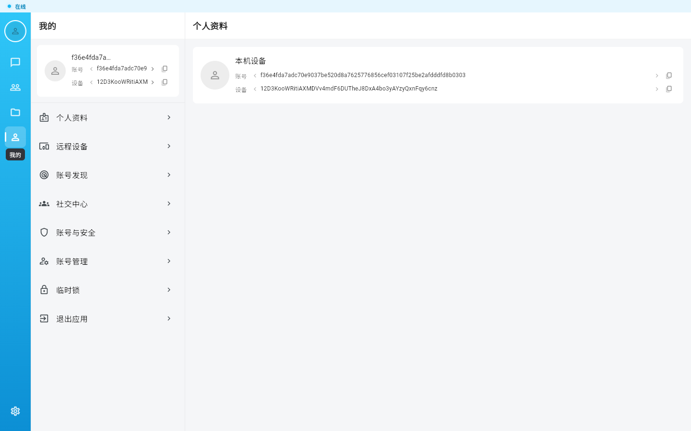 |

| 联系人：分组好友列表 | 会话：聊天与通话/远控工具栏 |
| :---: | :---: |
|  | 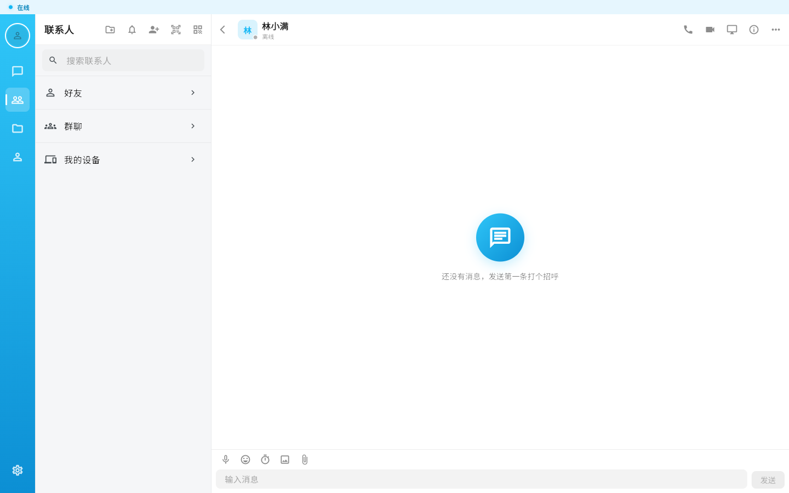 |

| 远程设备台账：类型筛选与群控 | 账号发现：签名广播与地图入口 |
| :---: | :---: |
| 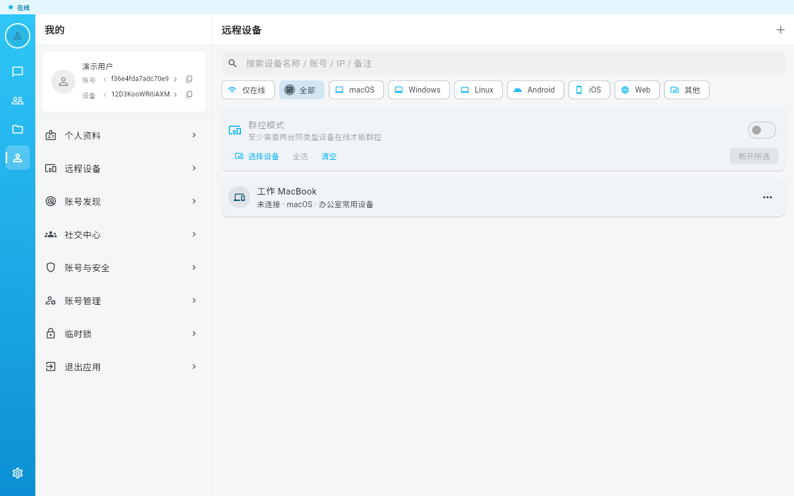 | 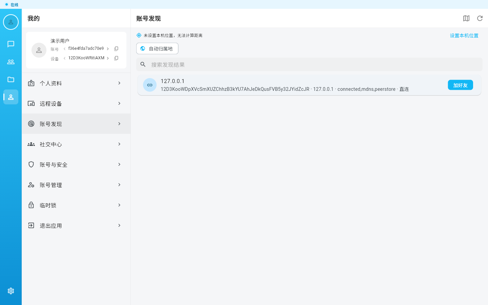 |

| 文件与传输：共享 / 传输 / 下载 | 设置：中继与发现源配置 |
| :---: | :---: |
| 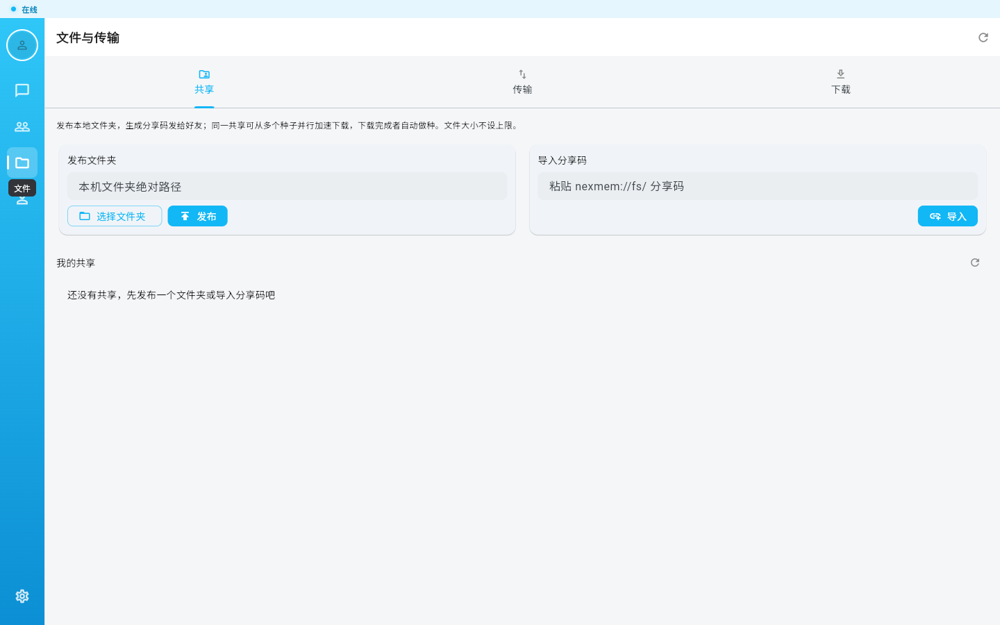 | 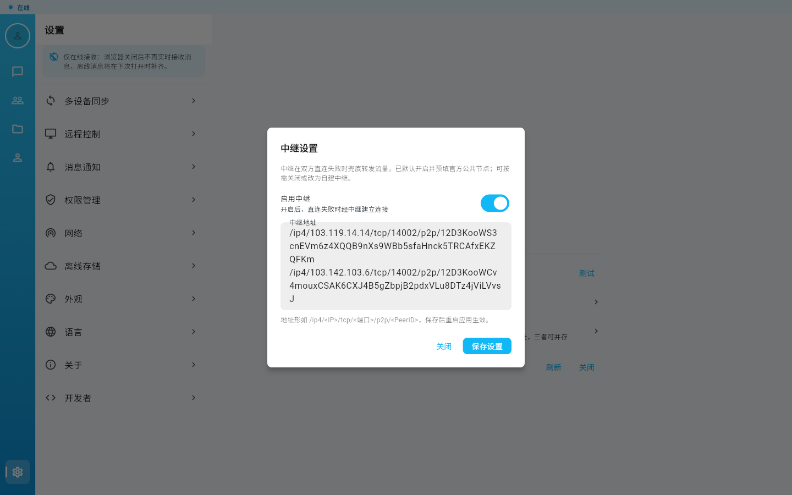 |

| 网络诊断与连接自检 | 阿拉伯语 RTL 布局 |
| :---: | :---: |
| 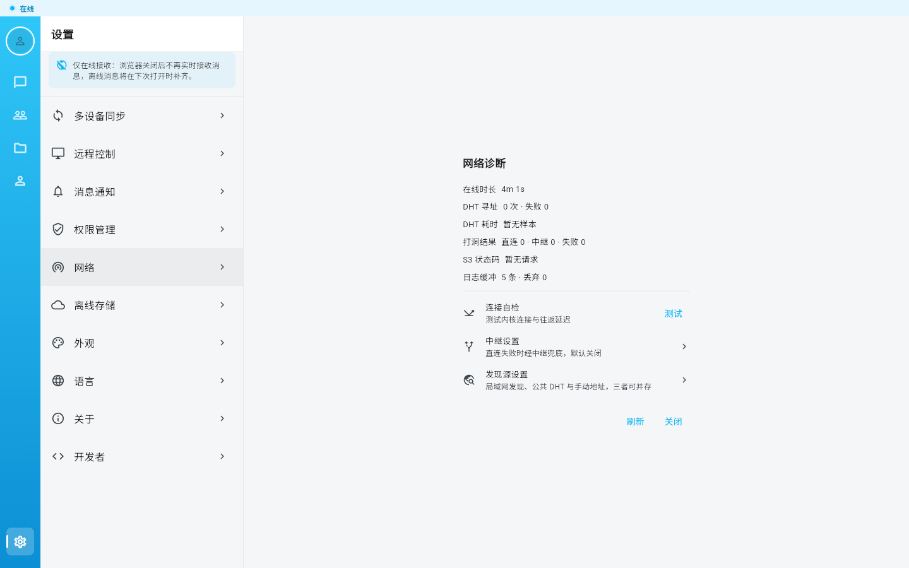 |  |

### 移动布局（430×932）· 底部 Tab + 全屏页面

| 消息 | 联系人 |
| :---: | :---: |
| 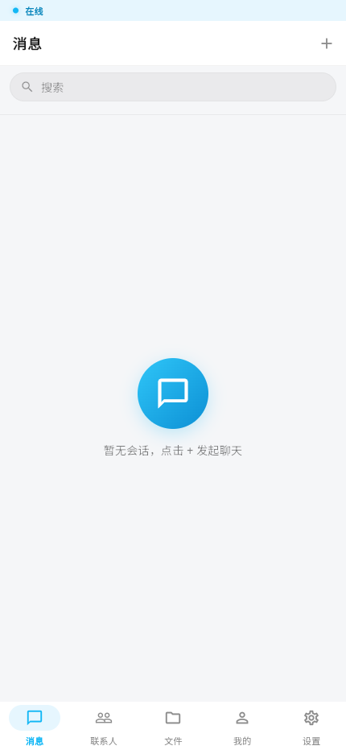 |  |

| 我的 | 设置 |
| :---: | :---: |
| 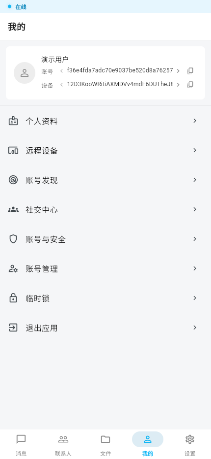 | 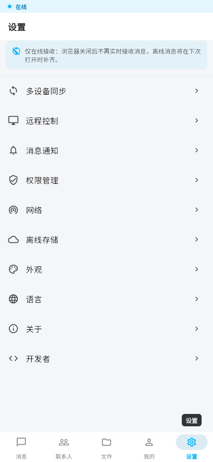 |

| 个人资料编辑 | 账号发现 |
| :---: | :---: |
| 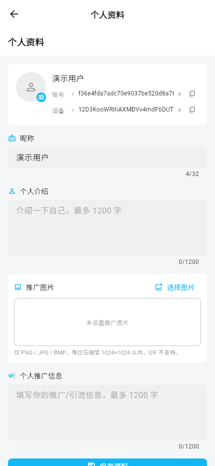 | 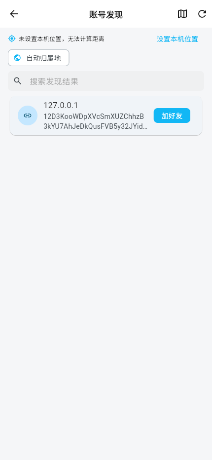 |

| 启动服务检测门（进度 + 失败兜底） |
| :---: |
| 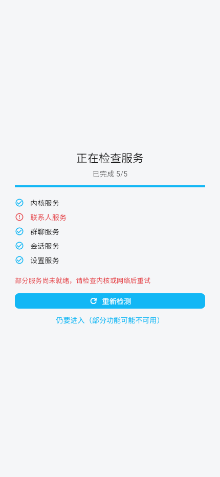 |

## 下载安装（推荐）

前往 [GitHub Releases 最新版](https://github.com/huangyu8733/nexmem/releases/latest) 下载对应平台的安装包：

| 平台 | 资产文件 | 说明 |
| --- | --- | --- |
| Windows x64 | `Nexmem-*-windows-x64.zip` | 解压即用，附带 `install.ps1` / `uninstall.ps1` |
| macOS arm64 (Apple Silicon) | `Nexmem-*-macos-arm64.zip` | 解压后拖入「应用程序」 |
| Linux x64 | `Nexmem-*-linux-x64.deb` 或 `.tar.gz` | Debian/Ubuntu 用 `.deb`，其他发行版用 tarball |
| Android | `Nexmem-*-android.apk` | 允许“安装未知来源应用”后安装 |
| Web | `Nexmem-*-web.zip` | 静态站点，解压后用任意 Web 服务器托管 |

### 应用内在线升级

桌面端与 Android 可在 **设置 → 关于 → 检查更新**：应用会调用 GitHub Releases API
查询最新版，展示 Release 说明，并下载当前平台对应的安装包到临时目录。下载完成后
打开所在目录，Windows 用户运行 `install.ps1` 完成升级，Android 用户点击 APK 安装。
浏览器版（Web）不支持就地升级，请在发布页手动下载。

> 升级不会自动替换正在运行的程序，避免文件占用导致数据损坏；也不会删除本地账号与
> 聊天数据（数据目录保持独立）。

📖 各平台详细步骤、首次配置、FAQ 见 **[安装与使用教程](docs/安装与使用教程.md)**。

> 跨网使用（不在同一 WiFi）需要一个可达的 directory + bootstrap。项目已提供**现成公共节点**，无需自建，地址与客户端配置见 [公网部署 → 现成公共节点](#现成公共节点可直接填写无需自建)。

> 桌面安装包已内置 Go 内核动态库（`nexmem.dll` / `libnexmem.so` / `libnexmem.dylib`）。请保持压缩包内的目录结构，不要只复制主程序。
>
> macOS 包由独立工作流构建，GitHub macOS 运行器排队时，该资产可能比其他平台稍晚出现在 Release 页面。

## 从源码构建

需要 Go 1.26+、Flutter 3.50+（Android 还需 JDK 17 与 Android SDK/NDK）。

```bash
# 桌面 Windows（PowerShell）
powershell -ExecutionPolicy Bypass -File deploy/desktop/build-windows.ps1

# 桌面 Linux（Ubuntu 需先安装 GTK3 等依赖）
bash deploy/linux/build-linux.sh

# Android（先生成 Go 内核 AAR）
make android-aar
cd app && flutter build apk --release

# iOS（macOS，先生成 Go 内核 XCFramework）
make ios-xcframework
cd app && flutter build ios --release --no-codesign

# Web
cd app && flutter build web --release
```

测试：`cd app && flutter test`，Go 侧：`make test`。

## 三种发现源（可并存，无需自建服务器也能用）

P2P 的数据传输是端到端的，但"找到对方"需要一个发现机制。Nexmem 内置**三种可同时启用、互不冲突**的发现源，按优先级串联（`本地地址簿 → 原目录/DHT → mDNS/已连接 → 公共 DHT`），任一命中即可直连：

| 发现源 | 开关 | 是否需要服务器 | 适用场景 |
| --- | --- | --- | --- |
| **手动地址 / 本地地址簿** | 始终生效 | ❌ 完全离线 | 扫码/复制对端 multiaddr，写入本机 KV；最高优先级 |
| **局域网发现（mDNS + LAN Beacon）** | 默认开启；`NEXMEM_MDNS=false` 可关闭 mDNS，LAN Beacon 独立工作 | ❌ 零基础设施 | 同一 WiFi 下的电脑/手机自动互联、自动通话；UDP 5357 签名广播，Android 可绕开 mDNS 权限限制 |
| **公共 DHT 兜底** | 默认开启；`NEXMEM_PUBLIC_DHT=false` 可关闭 | ❌ 用公共节点 | 无自建 bootstrap 时，借公共 IPFS 网络解析地址 |

- **零部署用法**：mDNS 与公共 DHT 默认已开启；两端连同一 WiFi 即可尝试局域网互联，无需 directory / bootstrap / relay（离线消息仍需 S3 存储）。若路由器开启 AP 隔离，需在路由器关闭该选项。
- **设置入口**：设置 → 网络 → 发现源设置（桌面/Android）。Web 端由网关通过 `-mdns` / `-public-dht` / `-manual-addrs` 或同名环境变量配置。
- **手动地址**：在「发现源设置」填入对端账号 ID（64 位 hex）、设备 PeerID 与 multiaddr（含 `/p2p/<PeerID>`），保存后写入本地地址簿并实时生效。
- 三种源与下面的自建基础设施**可以叠加**：既配 directory+bootstrap 用于跨网，又开 mDNS 用于局域网，公共 DHT 作为最后兜底。

## 公网部署（服务端）

> Nexmem 的 P2P **不是零服务器**：消息内容不经中心服务器，但若要跨网寻址与离线消息，就需要 directory 与 bootstrap。
> 若只想在同一局域网内使用，开启 mDNS 即可，无需部署下面任何组件。只配中继器并不能让任意两人连通。

### 现成公共节点（可直接填写，无需自建）

项目已部署两组公共节点，长时间在线。**直接复制下面的配置即可使用**，无需自己搭服务器。

| 节点 | directory | bootstrap PeerID | relay PeerID |
| --- | --- | --- | --- |
| 主节点 `103.119.14.14` | `http://103.119.14.14:8081` | `12D3KooWFV5aGaZ9nFepfiJaPkM18EzmFVC34Lg2LAY8Cv5JKrU2` | `12D3KooWS3cnEVm6z4XQQB9nXs9WBb5sfaHnck5TRCAfxEKZQFKm` |
| 备用 `103.142.103.6` | `http://103.142.103.6:8081` | `12D3KooWCbUVU3fQFfa44t8MHag7xVq3snMA9udR2EEXNS4xHEz3` | `12D3KooWCv4mouxCSAK6CXJ4B5gZbpjB2pdxVLu8DTz4jViLVvsJ` |

**部署形态与实测状态**

| 节点 | 部署内容 | 对外端口 | 运行方式 | 实测结果 |
| --- | --- | --- | --- | --- |
| `103.119.14.14` | directory + bootstrap + relay | `8081/tcp`、`14001/tcp+udp`、`14002/tcp+udp` | systemd 常驻、开机自启、异常自动重启 | 档案签名上传/回读、DHT 入网、纯中继回显全部通过；中继 RTT ≈ 0.3 s |
| `103.142.103.6` | directory + bootstrap + relay（独立账号库） | 同上 | 同上 | 同上；中继 RTT ≈ 1.4–4.6 s |

> 服务端数据在 `/var/lib/nexmem/`（`directory.db`、`bootstrap.key`、`relay.key`），公网 IP 配置在 `/etc/nexmem/server.env`。
> 自建时若沿用本仓库的 systemd 单元，可直接参考 [deploy/server/README.md](deploy/server/README.md)。
> 公共节点运维命令：`systemctl status nexmem-directory nexmem-bootstrap nexmem-relay`、`journalctl -u nexmem-relay -f`。

完整多地址（含 `/p2p/<PeerID>`，可直接粘贴到设置页）：

```
# bootstrap（主节点）
/ip4/103.119.14.14/tcp/14001/p2p/12D3KooWFV5aGaZ9nFepfiJaPkM18EzmFVC34Lg2LAY8Cv5JKrU2

# bootstrap（备用节点）
/ip4/103.142.103.6/tcp/14001/p2p/12D3KooWCbUVU3fQFfa44t8MHag7xVq3snMA9udR2EEXNS4xHEz3

# relay（主节点）
/ip4/103.119.14.14/tcp/14002/p2p/12D3KooWS3cnEVm6z4XQQB9nXs9WBb5sfaHnck5TRCAfxEKZQFKm

# relay（备用节点）
/ip4/103.142.103.6/tcp/14002/p2p/12D3KooWCv4mouxCSAK6CXJ4B5gZbpjB2pdxVLu8DTz4jViLVvsJ
```

> 想要 QUIC/UDP 时，把 `/tcp/14001` 换成 `/udp/14001/quic-v1`、`/tcp/14002` 换成 `/udp/14002/quic-v1`，PeerID 不变。

**桌面端**（设置页「网络 → 中继设置 / 发现源设置」填入上面的多地址后重启，或启动时注入）：

```bash
NEXMEM_DIRECTORY_URL='http://103.119.14.14:8081' \
NEXMEM_BOOTSTRAPS='/ip4/103.119.14.14/tcp/14001/p2p/12D3KooWFV5aGaZ9nFepfiJaPkM18EzmFVC34Lg2LAY8Cv5JKrU2' \
NEXMEM_RELAY_ADDRS='/ip4/103.119.14.14/tcp/14002/p2p/12D3KooWS3cnEVm6z4XQQB9nXs9WBb5sfaHnck5TRCAfxEKZQFKm,/ip4/103.142.103.6/tcp/14002/p2p/12D3KooWCv4mouxCSAK6CXJ4B5gZbpjB2pdxVLu8DTz4jViLVvsJ' \
  ./your-nexmem-app
```

**Android**（需带 `--dart-define` 重新打包，Git Bash 会误转 `/ip4/...`，请用 PowerShell）：

```powershell
flutter build apk --release `
  --dart-define=NEXMEM_DIRECTORY_URL=http://103.119.14.14:8081 `
  --dart-define=NEXMEM_BOOTSTRAPS=/ip4/103.119.14.14/tcp/14001/p2p/12D3KooWFV5aGaZ9nFepfiJaPkM18EzmFVC34Lg2LAY8Cv5JKrU2 `
  --dart-define=NEXMEM_RELAY_ADDRS=/ip4/103.119.14.14/tcp/14002/p2p/12D3KooWS3cnEVm6z4XQQB9nXs9WBb5sfaHnck5TRCAfxEKZQFKm,/ip4/103.142.103.6/tcp/14002/p2p/12D3KooWCv4mouxCSAK6CXJ4B5gZbpjB2pdxVLu8DTz4jViLVvsJ
```

**Web 网关**：

```bash
NEXMEM_DATA_DIR=/srv/nexmem/data \
NEXMEM_DIRECTORY_URL='http://103.119.14.14:8081' \
NEXMEM_BOOTSTRAPS='/ip4/103.119.14.14/tcp/14001/p2p/12D3KooWFV5aGaZ9nFepfiJaPkM18EzmFVC34Lg2LAY8Cv5JKrU2' \
NEXMEM_RELAY_ADDRS='/ip4/103.119.14.14/tcp/14002/p2p/12D3KooWS3cnEVm6z4XQQB9nXs9WBb5sfaHnck5TRCAfxEKZQFKm,/ip4/103.142.103.6/tcp/14002/p2p/12D3KooWCv4mouxCSAK6CXJ4B5gZbpjB2pdxVLu8DTz4jViLVvsJ' \
  ./bin/nexmem-webd -token-file ./deploy/web/data/token
```

> Web 端内核运行在网关进程内，浏览器拿不到服务端路径：选择本机文件/目录时经鉴权 `POST /upload` 上传落地；群文件下载落到数据目录下的 `web-downloads/`，再经鉴权 `GET /download?path=...` 取回浏览器保存。聊天媒体在线播放使用同一端点的 `disposition=inline` 参数，返回 `Content-Disposition: inline` 并保留 `Range`/`If-Range`/`HEAD` 支持；保存到本机仍使用默认 `attachment`。两个端点共用访问令牌，`/download` 仅放行上传目录与 `web-downloads/`、`inbox/` 白名单，并有路径穿越与符号链接逃逸防护。上传落地目录可用 `-upload-dir` 覆盖。
>
> ⚠️ 两台节点各有独立的 directory 数据库：**所有客户端请统一用同一台 directory + 对应 bootstrap**（推荐 `103.119.14.14`），否则账号数据不互通。
> 两个 relay 可以同时填进 `NEXMEM_RELAY_ADDRS`，跨运营商 / 对称 NAT 下兜底成功率更高。
> 公共节点仅提供寻址与中继，消息仍端到端加密、不经服务器落盘。
>
> 官方 Release 的安装包**未预置**上述节点：桌面端可在「设置 → 网络」填写或在启动时注入环境变量；Android 没有中继设置入口，需按上面的 `--dart-define` 命令自行重打包。

### 需要部署什么

| 组件 | 默认端口 | 作用 | 必需性 |
| --- | --- | --- | --- |
| `nexmem-directory` | `8081/tcp` | 账号 → 设备公钥映射、离线上传票据池 | ✅ 必需 |
| `nexmem-bootstrap` | `14001/tcp` + `14001/udp` | 私有 DHT 第一跳，节点发现入口 | ✅ 必需 |
| `nexmem-relay` | `14002/tcp` + `14002/udp` | 直连/打洞失败时的 Circuit Relay v2 兜底 | 直连失败时需要 |

relay 只转发加密字节并做带宽计数，**看不到明文、不持久化任何消息**，所以多个中继器之间
没有连接、没有状态、也没有同步接口。真正让不同网络的用户互通的是共享的 DHT / directory
与共同的中继地址列表，而不是中继之间的数据同步。

### 方式一：Docker Compose（推荐，Linux / Windows / macOS 通用）

```bash
cp deploy/.env.example deploy/.env
# 编辑 deploy/.env：把 NEXMEM_PUBLIC_IP 改成服务器真实公网 IP

docker compose -f deploy/docker-compose.yml up -d --build
docker compose -f deploy/docker-compose.yml ps
docker compose -f deploy/docker-compose.yml logs bootstrap
```

`bootstrap` / `relay` 的启动日志会输出一行 JSON，其中的 `peer_id` 用于拼客户端要填的多地址。

### 方式二：原生脚本部署（Linux / macOS / Windows）

```bash
# Linux / macOS
export NEXMEM_PUBLIC_IP=1.2.3.4
./deploy/server/start.sh build     # 只编译三个二进制到 bin/
./deploy/server/start.sh all       # directory/relay 后台，bootstrap 前台
```

```powershell
# Windows
powershell -ExecutionPolicy Bypass -File deploy/server/start.ps1 -PublicIp 1.2.3.4
```

Linux 服务器可用仓库自带的 systemd 单元配置开机自启（详见 `deploy/server/README.md`）。
防火墙/安全组需**同时放行 TCP 与 UDP** 的 14001、14002，以及 TCP 8081。
`-announce` 必须写真实公网 IP 与对外端口，写 `127.0.0.1` 会导致其他节点无法拨号。

### 客户端接入

> 只想直接用公共节点：跳过本节，复制上方「现成公共节点」里的命令即可。下面以 `1.2.3.4` 为例说明自建节点的通用接入方式。

拼出引导地址（用 bootstrap 日志里的 PeerID）：

```
/ip4/1.2.3.4/tcp/14001/p2p/12D3KooW...
```

relay 地址同理，把端口换成 14002 并使用 relay 自己的 PeerID。

| 平台 | 配置方式 |
| --- | --- |
| 桌面端 | 设置页「网络 → 中继设置 / 发现源设置」写入后重启；或设置 `NEXMEM_BOOTSTRAPS`、`NEXMEM_DIRECTORY_URL`、`NEXMEM_RELAY_ADDRS`、`NEXMEM_MDNS`、`NEXMEM_PUBLIC_DHT`、`NEXMEM_MANUAL_ADDRS` 后启动 |
| Android | 需带 `--dart-define` 重新构建 APK（见下方命令），移动端没有设置页中继入口 |
| Web | 浏览器内核运行在 `nexmem-webd` 进程内，必须在**网关**配置，设置页配置对 Web 无效 |

```powershell
# Android APK 注入公网基础设施（用 PowerShell，Git Bash 会把 /ip4/... 误转成本地路径）
flutter build apk --release `
  --dart-define=NEXMEM_BOOTSTRAPS=/ip4/1.2.3.4/tcp/14001/p2p/12D3Koo... `
  --dart-define=NEXMEM_DIRECTORY_URL=http://1.2.3.4:8081 `
  --dart-define=NEXMEM_RELAY_ADDRS=/ip4/1.2.3.4/tcp/14002/p2p/12D3Koo... `
  --dart-define=NEXMEM_MDNS=true `
  --dart-define=NEXMEM_PUBLIC_DHT=true
```

```bash
# Web 网关注入（发现源用 -mdns / -public-dht 或同名环境变量）
NEXMEM_DATA_DIR=/srv/nexmem/data \
NEXMEM_BOOTSTRAPS='/ip4/1.2.3.4/tcp/14001/p2p/12D3Koo...' \
NEXMEM_DIRECTORY_URL='http://1.2.3.4:8081' \
NEXMEM_RELAY_ADDRS='/ip4/1.2.3.4/tcp/14002/p2p/12D3Koo...' \
NEXMEM_MDNS=true \
NEXMEM_PUBLIC_DHT=true \
  ./bin/nexmem-webd -token-file ./deploy/web/data/token
```

> 只在同一 WiFi 下用：把上面所有公网地址都去掉，仅保留 `NEXMEM_MDNS=true`，两端即可自动发现互相通话。

多个中继用逗号分隔，建议部署 2~3 个公网节点让所有客户端填同一份列表。中继在 host 创建时装配，
**改完配置必须重启客户端**（Web 则重启网关）。

### 验证部署

1. `curl http://<服务器IP>:8081/` 不再是连接拒绝（directory 未注册根路径，404 属正常）。
2. 客户端「网络诊断」能看到 DHT 入网与目录服务可达。
3. 加好友发消息：直连失败时状态显示「经中继」，DCUtR 打洞成功后自动升级为直连。
4. `docker compose logs relay` 无 `RELAY_QUOTA_ALERT`；出现说明带宽超限，需调大 `-bandwidth`。

📖 完整参数、systemd 单元、多中继池与故障排查见 **[服务端部署文档](deploy/server/README.md)**；
Web 网关专用说明见 [deploy/web/README.md](deploy/web/README.md)。

## 自动发布

推送 `v*` 标签即触发 [Release 工作流](.github/workflows/release.yml)：云端并行构建 Windows / Linux / macOS / Android / Web，自动创建 GitHub Release 并上传安装包。iOS 工程与 XCFramework 已随源码提供，但 Release 暂未产出正式 IPA，需在 macOS 上自行构建签名。

```bash
git tag v1.0.3
git push origin v1.0.3
```

## 文档

- [安装与使用教程](docs/安装与使用教程.md)
- [服务端公网部署](deploy/server/README.md)
- [Web 自托管部署](deploy/web/README.md)
- [工程实施方案](docs/Nexmem-engineering-plan.md)
- [开发进度文档](docs/开发进度文档.md)
- [剩余开发进度](docs/剩余开发进度.md)
- [UI 规范](docs/ui-spec.md)

内部包名 `nexmem_app` 仅用于构建与部署脚本；产品显示名为 **Nexmem / 奈讯联**。
