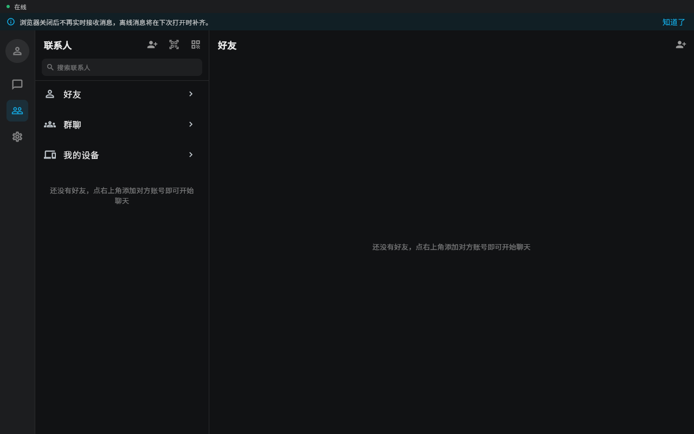

<p align="center">
  
</p>

<p align="center">
  <a href="https://github.com/huangyu8733/nexmem/actions/workflows/ci.yml"></a>
  <a href="https://github.com/huangyu8733/nexmem/releases/latest"></a>
  
</p>

# Nexmem（奈讯联）

**本地优先、端到端加密的去中心化 P2P 即时通讯系统。** 一套 Go 内核 + Flutter 界面，覆盖 Windows / macOS / Linux / Android / Web，33 种界面语言（含阿拉伯语、希伯来语 RTL 布局）。

## 项目介绍

### 背景与定位

主流 IM 的消息必须经过平台中心服务器，聊天记录、关系链与元数据都由平台托管。Nexmem 的定位是**把消息链路还给设备**：两个客户端通过 `go-libp2p` 建立的 DHT / Relay 网络直接发现并连接，消息经 X25519 + HKDF + AES-GCM 端到端加密后直连投递；中继节点只转发密文、无法解密，也没有一个"中心数据库"保存你的聊天内容。

当对方不在线时，密文会暂存到**你自己选择的 S3 兼容对象存储**（Cloudflare R2、MinIO、阿里云 OSS、腾讯云 COS、Backblaze B2、个人 NAS 等），对方上线后自行拉取与解密。凭证采用**上传票据池模型**：发送方只签发短期预签名 URL，永远拿不到接收方的主密钥。

### 架构概览

```
┌──────────────────────────────────────────────┐
│  Flutter UI（Windows / macOS / Linux /       │
│              Android / Web）                  │
│  聊天 · 群聊 · 联系人 · 设置 · 文件 · 音视频   │
└───────────────────┬──────────────────────────┘
                    │ 统一契约：56 方法 / 16 事件
┌───────────────────▼──────────────────────────┐
│  Go 内核 core/                                │
│  libp2p · crypto · SQLite(FTS5) · dm · group  │
│  blob(S3) · rtc(信令) · identity · relay      │
└───────────────────┬──────────────────────────┘
        ┌───────────┼────────────┬─────────────┐
   c-shared      gomobile      webd 网关
  （桌面 DLL/SO）  （Android AAR） （Web WebSocket）
```

- **一套协议实现**：所有平台复用同一个 Go 内核，避免多端行为不一致；桌面通过 `dart:ffi` 加载 c-shared 库，Android 通过 gomobile AAR，Web 通过网关接入同一套语义。
- **本地优先**：消息、会话与设置存本机 SQLite（纯 Go 驱动 + 字段级加密），FTS5 支持万条消息下 <100ms 全文检索；断网时仍可查看历史与编辑，恢复连接后自动补发/补齐。
- **双层密钥**：账号密钥 + 设备密钥分离，同一账号可在多台设备共存而不冲突；备份包可在新设备恢复全部密钥与历史。

### 技术选型

| 层次 | 选型 | 说明 |
| --- | --- | --- |
| P2P 网络 | `go-libp2p` | DHT 发现、NAT 打洞、Relay v2、GossipSub 群播 |
| 加密 | X25519 + HKDF + AES-GCM | 消息端到端加密；账号 ed25519 签名 |
| 本地存储 | `modernc.org/sqlite` + FTS5 | 纯 Go 无 cgo，应用层字段级透明加密 |
| 离线投递 | S3 兼容对象存储 + 预签名票据 | 6 家服务商 + 个人 NAS，票据不泄露主密钥 |
| 音视频 | `flutter_webrtc` + Go 信令 | Go 只交换 SDP/ICE，媒体面走 WebRTC |
| 界面 | Flutter 3.50 / Dart 3.14 | 一套代码覆盖五端，含 RTL 自动布局 |

### 核心能力

- **单聊 / 群聊**：端到端加密文本、文件、图片与语音消息；@成员、引用回复、消息编辑、输入中状态、定时消息与阅后即焚。
- **群云盘**：群密钥保护下的离线附件与生命周期清理，管理员可移除群盘配置，解散群组时同步清理云端密文。
- **联系人与设备**：好友分组、二维码交换名片、设备管理、跨设备已读水位同步与设置快照迁移。
- **可靠性**：断线重连、离线消息补发、群聊离线补齐、链路中断 30 秒不丢不重。
- **个人资料**：昵称、个人介绍、推广图与头像（支持裁剪，头像固定 1:1），账号与设备 ID 完整显示并可一键复制。
- **隐私与备份**：加密备份导出/导入、受限子密钥校验、账号与安全设置、网络诊断与连接自检。

> 设计取舍：一期使用静态密钥加密（已写入威胁模型，未实现 Double Ratchet），不做消息漫游、跨账号云端备份与群历史回溯给新成员；真机 / 公网量化验收项按项目文档的口径独立登记。

## 界面预览

### 桌面端 · 三栏布局 + 右栏详情

| 个人资料（只读展示 / 复制账号） | 设置项（右栏常驻） |
| :---: | :---: |
|  |  |

| 联系人与好友（右栏展示） | 阿拉伯语 RTL 布局 |
| :---: | :---: |
|  |  |

### 移动端 · 全屏页面

| 个人资料编辑 | 设置项全屏页（多设备同步） |
| :---: | :---: |
|  |  |

## 下载安装（推荐）

前往 [GitHub Releases 最新版](https://github.com/huangyu8733/nexmem/releases/latest) 下载对应平台的安装包：

| 平台 | 资产文件 | 说明 |
| --- | --- | --- |
| Windows x64 | `Nexmem-*-windows-x64.zip` | 解压即用，附带 `install.ps1` / `uninstall.ps1` |
| macOS arm64 (Apple Silicon) | `Nexmem-*-macos-arm64.zip` | 解压后拖入「应用程序」 |
| Linux x64 | `Nexmem-*-linux-x64.deb` 或 `.tar.gz` | Debian/Ubuntu 用 `.deb`，其他发行版用 tarball |
| Android | `Nexmem-*-android.apk` | 允许“安装未知来源应用”后安装 |
| Web | `Nexmem-*-web.zip` | 静态站点，解压后用任意 Web 服务器托管 |

📖 各平台详细步骤、首次配置、FAQ 见 **[安装与使用教程](docs/安装与使用教程.md)**。

> 桌面安装包已内置 Go 内核动态库（`nexmem.dll` / `libnexmem.so` / `libnexmem.dylib`）。请保持压缩包内的目录结构，不要只复制主程序。
>
> macOS 包由独立工作流构建，GitHub macOS 运行器排队时，该资产可能比其他平台稍晚出现在 Release 页面。

## 从源码构建

需要 Go 1.26+、Flutter 3.50+（Android 还需 JDK 17 与 Android SDK/NDK）。

```bash
# 桌面 Windows（PowerShell）
powershell -ExecutionPolicy Bypass -File deploy/desktop/build-windows.ps1

# 桌面 Linux（Ubuntu 需先安装 GTK3 等依赖）
bash deploy/linux/build-linux.sh

# Android（先生成 Go 内核 AAR）
make android-aar
cd app && flutter build apk --release

# Web
cd app && flutter build web --release
```

测试：`cd app && flutter test`，Go 侧：`make test`。

## 自动发布

推送 `v*` 标签即触发 [Release 工作流](.github/workflows/release.yml)：云端并行构建 Windows / Linux / macOS / Android / Web，自动创建 GitHub Release 并上传安装包。

```bash
git tag v1.0.3
git push origin v1.0.3
```

## 文档

- [安装与使用教程](docs/安装与使用教程.md)
- [工程实施方案](docs/Nexmem-engineering-plan.md)
- [开发进度文档](docs/开发进度文档.md)
- [剩余开发进度](docs/剩余开发进度.md)
- [UI 规范](docs/ui-spec.md)

内部包名 `nexmem_app` 仅用于构建与部署脚本；产品显示名为 **Nexmem / 奈讯联**。
