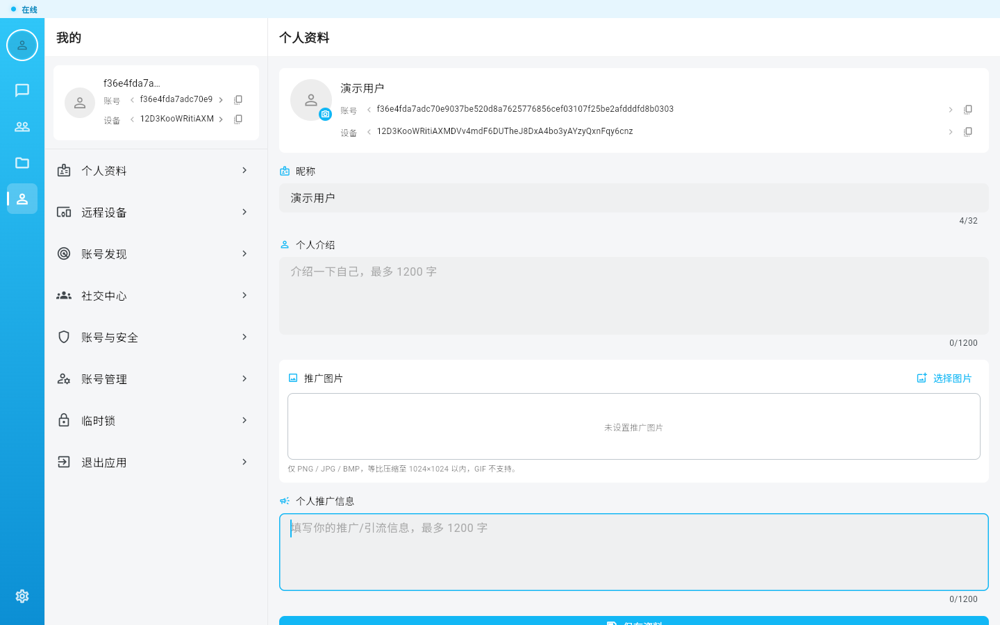
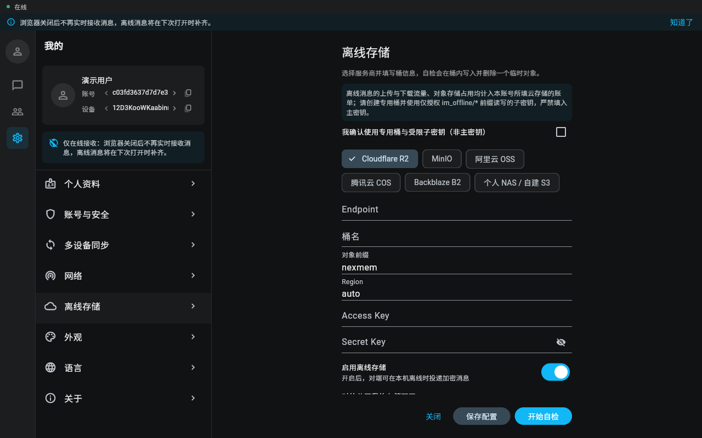
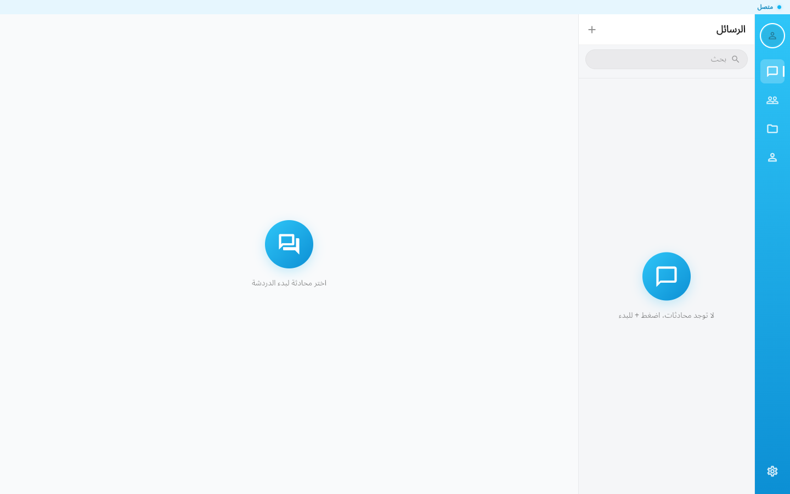

<p align="center">
  
</p>

<p align="center">
  <a href="https://github.com/huangyu8733/nexmem/actions/workflows/ci.yml"></a>
  <a href="https://github.com/huangyu8733/nexmem/releases/latest"></a>
  
</p>

# Nexmem（奈讯联）

**本地优先、端到端加密的去中心化 P2P 即时通讯系统。** 一套 Go 内核 + Flutter 界面，覆盖 Windows / macOS / Linux / Android / Web，33 种界面语言（含阿拉伯语、希伯来语 RTL 布局）。

## 项目介绍

### 背景与定位

主流 IM 的消息必须经过平台中心服务器，聊天记录、关系链与元数据都由平台托管。Nexmem 的定位是**把消息链路还给设备**：两个客户端通过 `go-libp2p` 建立的 DHT / Relay 网络直接发现并连接，消息经 X25519 + HKDF + AES-GCM 端到端加密后直连投递；中继节点只转发密文、无法解密，也没有一个"中心数据库"保存你的聊天内容。

当对方不在线时，密文会暂存到**你自己选择的 S3 兼容对象存储**（Cloudflare R2、MinIO、阿里云 OSS、腾讯云 COS、Backblaze B2、个人 NAS 等），对方上线后自行拉取与解密。凭证采用**上传票据池模型**：发送方只签发短期预签名 URL，永远拿不到接收方的主密钥。

### 架构概览

```
┌──────────────────────────────────────────────┐
│  Flutter UI（Windows / macOS / Linux /       │
│              Android / Web）                  │
│  聊天 · 群聊 · 联系人 · 设置 · 文件 · 音视频   │
└───────────────────┬──────────────────────────┘
                    │ 统一契约：56 方法 / 16 事件
┌───────────────────▼──────────────────────────┐
│  Go 内核 core/                                │
│  libp2p · crypto · SQLite(FTS5) · dm · group  │
│  blob(S3) · rtc(信令) · identity · relay      │
└───────────────────┬──────────────────────────┘
        ┌───────────┼────────────┬─────────────┐
   c-shared      gomobile      webd 网关
  （桌面 DLL/SO）  （Android AAR） （Web WebSocket）
```

- **一套协议实现**：所有平台复用同一个 Go 内核，避免多端行为不一致；桌面通过 `dart:ffi` 加载 c-shared 库，Android 通过 gomobile AAR，Web 通过网关接入同一套语义。
- **本地优先**：消息、会话与设置存本机 SQLite（纯 Go 驱动 + 字段级加密），FTS5 支持万条消息下 <100ms 全文检索；断网时仍可查看历史与编辑，恢复连接后自动补发/补齐。
- **双层密钥**：账号密钥 + 设备密钥分离，同一账号可在多台设备共存而不冲突；备份包可在新设备恢复全部密钥与历史。

### 技术选型

| 层次 | 选型 | 说明 |
| --- | --- | --- |
| P2P 网络 | `go-libp2p` | DHT 发现、NAT 打洞、Relay v2、GossipSub 群播 |
| 加密 | X25519 + HKDF + AES-GCM | 消息端到端加密；账号 ed25519 签名 |
| 本地存储 | `modernc.org/sqlite` + FTS5 | 纯 Go 无 cgo，应用层字段级透明加密 |
| 离线投递 | S3 兼容对象存储 + 预签名票据 | 6 家服务商 + 个人 NAS，票据不泄露主密钥 |
| 音视频 | `flutter_webrtc` + Go 信令 | Go 只交换 SDP/ICE，媒体面走 WebRTC |
| 界面 | Flutter 3.50 / Dart 3.14 | 一套代码覆盖五端，含 RTL 自动布局 |

### 核心能力

- **单聊 / 群聊**：端到端加密文本、文件、图片与语音消息；@成员、引用回复、消息编辑、输入中状态、定时消息与阅后即焚。
- **群云盘**：群密钥保护下的离线附件与生命周期清理，管理员可移除群盘配置，解散群组时同步清理云端密文。
- **联系人与设备**：好友分组、二维码交换名片、设备管理、跨设备已读水位同步与设置快照迁移。
- **可靠性**：断线重连、离线消息补发、群聊离线补齐、链路中断 30 秒不丢不重。
- **语音/视频通话**：单聊语音与视频（含摄像头开关、前后摄切换）；群聊支持最多 4 人全互联（Mesh）语音/视频，成员网格布局。Go 内核只做信令透传，媒体面端到端直连，不解密、不录制。
- **个人资料**：昵称、个人介绍、推广图与头像（支持裁剪，头像固定 1:1），账号与设备 ID 完整显示并可一键复制。
- **隐私与备份**：加密备份导出/导入、受限子密钥校验、账号与安全设置、网络诊断与连接自检。

> 设计取舍：一期使用静态密钥加密（已写入威胁模型，未实现 Double Ratchet），不做消息漫游、跨账号云端备份与群历史回溯给新成员；真机 / 公网量化验收项按项目文档的口径独立登记。

## 界面预览

### 桌面端 · 三栏布局 + 右栏详情

| 个人资料（只读展示 / 复制账号） | 设置项（右栏常驻） |
| :---: | :---: |
|  |  |

| 联系人与好友（右栏展示） | 阿拉伯语 RTL 布局 |
| :---: | :---: |
|  |  |

### 移动端 · 全屏页面

| 个人资料编辑 | 设置项全屏页（多设备同步） |
| :---: | :---: |
|  |  |

## 下载安装（推荐）

前往 [GitHub Releases 最新版](https://github.com/huangyu8733/nexmem/releases/latest) 下载对应平台的安装包：

| 平台 | 资产文件 | 说明 |
| --- | --- | --- |
| Windows x64 | `Nexmem-*-windows-x64.zip` | 解压即用，附带 `install.ps1` / `uninstall.ps1` |
| macOS arm64 (Apple Silicon) | `Nexmem-*-macos-arm64.zip` | 解压后拖入「应用程序」 |
| Linux x64 | `Nexmem-*-linux-x64.deb` 或 `.tar.gz` | Debian/Ubuntu 用 `.deb`，其他发行版用 tarball |
| Android | `Nexmem-*-android.apk` | 允许“安装未知来源应用”后安装 |
| Web | `Nexmem-*-web.zip` | 静态站点，解压后用任意 Web 服务器托管 |

### 应用内在线升级

桌面端与 Android 可在 **设置 → 关于 → 检查更新**：应用会调用 GitHub Releases API
查询最新版，展示 Release 说明，并下载当前平台对应的安装包到临时目录。下载完成后
打开所在目录，Windows 用户运行 `install.ps1` 完成升级，Android 用户点击 APK 安装。
浏览器版（Web）不支持就地升级，请在发布页手动下载。

> 升级不会自动替换正在运行的程序，避免文件占用导致数据损坏；也不会删除本地账号与
> 聊天数据（数据目录保持独立）。

📖 各平台详细步骤、首次配置、FAQ 见 **[安装与使用教程](docs/安装与使用教程.md)**。

> 桌面安装包已内置 Go 内核动态库（`nexmem.dll` / `libnexmem.so` / `libnexmem.dylib`）。请保持压缩包内的目录结构，不要只复制主程序。
>
> macOS 包由独立工作流构建，GitHub macOS 运行器排队时，该资产可能比其他平台稍晚出现在 Release 页面。

## 从源码构建

需要 Go 1.26+、Flutter 3.50+（Android 还需 JDK 17 与 Android SDK/NDK）。

```bash
# 桌面 Windows（PowerShell）
powershell -ExecutionPolicy Bypass -File deploy/desktop/build-windows.ps1

# 桌面 Linux（Ubuntu 需先安装 GTK3 等依赖）
bash deploy/linux/build-linux.sh

# Android（先生成 Go 内核 AAR）
make android-aar
cd app && flutter build apk --release

# Web
cd app && flutter build web --release
```

测试：`cd app && flutter test`，Go 侧：`make test`。

## 三种发现源（可并存，无需自建服务器也能用）

P2P 的数据传输是端到端的，但"找到对方"需要一个发现机制。Nexmem 内置**三种可同时启用、互不冲突**的发现源，按优先级串联（`本地地址簿 → 原目录/DHT → mDNS/已连接 → 公共 DHT`），任一命中即可直连：

| 发现源 | 开关 | 是否需要服务器 | 适用场景 |
| --- | --- | --- | --- |
| **手动地址 / 本地地址簿** | 始终生效 | ❌ 完全离线 | 扫码/复制对端 multiaddr，写入本机 KV；最高优先级 |
| **局域网发现 (mDNS)** | 默认开启；`NEXMEM_MDNS=false` 可关闭 | ❌ 零基础设施 | 同一 WiFi 下的电脑/手机自动互联、自动通话 |
| **公共 DHT 兜底** | 默认开启；`NEXMEM_PUBLIC_DHT=false` 可关闭 | ❌ 用公共节点 | 无自建 bootstrap 时，借公共 IPFS 网络解析地址 |

- **零部署用法**：mDNS 与公共 DHT 默认已开启；两端连同一 WiFi 即可尝试局域网互联，无需 directory / bootstrap / relay（离线消息仍需 S3 存储）。若路由器开启 AP 隔离，需在路由器关闭该选项。
- **设置入口**：设置 → 网络 → 发现源设置（桌面/Android）。Web 端由网关通过 `-mdns` / `-public-dht` / `-manual-addrs` 或同名环境变量配置。
- **手动地址**：在「发现源设置」填入对端账号 ID（64 位 hex）、设备 PeerID 与 multiaddr（含 `/p2p/<PeerID>`），保存后写入本地地址簿并实时生效。
- 三种源与下面的自建基础设施**可以叠加**：既配 directory+bootstrap 用于跨网，又开 mDNS 用于局域网，公共 DHT 作为最后兜底。

## 公网部署（服务端）

> Nexmem 的 P2P **不是零服务器**：消息内容不经中心服务器，但若要跨网寻址与离线消息，就需要 directory 与 bootstrap。
> 若只想在同一局域网内使用，开启 mDNS 即可，无需部署下面任何组件。只配中继器并不能让任意两人连通。

### 需要部署什么

| 组件 | 默认端口 | 作用 | 必需性 |
| --- | --- | --- | --- |
| `nexmem-directory` | `8081/tcp` | 账号 → 设备公钥映射、离线上传票据池 | ✅ 必需 |
| `nexmem-bootstrap` | `14001/tcp` + `14001/udp` | 私有 DHT 第一跳，节点发现入口 | ✅ 必需 |
| `nexmem-relay` | `14002/tcp` + `14002/udp` | 直连/打洞失败时的 Circuit Relay v2 兜底 | 直连失败时需要 |

relay 只转发加密字节并做带宽计数，**看不到明文、不持久化任何消息**，所以多个中继器之间
没有连接、没有状态、也没有同步接口。真正让不同网络的用户互通的是共享的 DHT / directory
与共同的中继地址列表，而不是中继之间的数据同步。

### 方式一：Docker Compose（推荐，Linux / Windows / macOS 通用）

```bash
cp deploy/.env.example deploy/.env
# 编辑 deploy/.env：把 NEXMEM_PUBLIC_IP 改成服务器真实公网 IP

docker compose -f deploy/docker-compose.yml up -d --build
docker compose -f deploy/docker-compose.yml ps
docker compose -f deploy/docker-compose.yml logs bootstrap
```

`bootstrap` / `relay` 的启动日志会输出一行 JSON，其中的 `peer_id` 用于拼客户端要填的多地址。

### 方式二：原生脚本部署（Linux / macOS / Windows）

```bash
# Linux / macOS
export NEXMEM_PUBLIC_IP=1.2.3.4
./deploy/server/start.sh build     # 只编译三个二进制到 bin/
./deploy/server/start.sh all       # directory/relay 后台，bootstrap 前台
```

```powershell
# Windows
powershell -ExecutionPolicy Bypass -File deploy/server/start.ps1 -PublicIp 1.2.3.4
```

Linux 服务器可用仓库自带的 systemd 单元配置开机自启（详见 `deploy/server/README.md`）。
防火墙/安全组需**同时放行 TCP 与 UDP** 的 14001、14002，以及 TCP 8081。
`-announce` 必须写真实公网 IP 与对外端口，写 `127.0.0.1` 会导致其他节点无法拨号。

### 客户端接入

拼出引导地址（用 bootstrap 日志里的 PeerID）：

```
/ip4/1.2.3.4/tcp/14001/p2p/12D3KooW...
```

relay 地址同理，把端口换成 14002 并使用 relay 自己的 PeerID。

| 平台 | 配置方式 |
| --- | --- |
| 桌面端 | 设置页「网络 → 中继设置 / 发现源设置」写入后重启；或设置 `NEXMEM_BOOTSTRAPS`、`NEXMEM_DIRECTORY_URL`、`NEXMEM_RELAY_ADDRS`、`NEXMEM_MDNS`、`NEXMEM_PUBLIC_DHT`、`NEXMEM_MANUAL_ADDRS` 后启动 |
| Android | 需带 `--dart-define` 重新构建 APK（见下方命令），移动端没有设置页中继入口 |
| Web | 浏览器内核运行在 `nexmem-webd` 进程内，必须在**网关**配置，设置页配置对 Web 无效 |

```powershell
# Android APK 注入公网基础设施（用 PowerShell，Git Bash 会把 /ip4/... 误转成本地路径）
flutter build apk --release `
  --dart-define=NEXMEM_BOOTSTRAPS=/ip4/1.2.3.4/tcp/14001/p2p/12D3Koo... `
  --dart-define=NEXMEM_DIRECTORY_URL=http://1.2.3.4:8081 `
  --dart-define=NEXMEM_RELAY_ADDRS=/ip4/1.2.3.4/tcp/14002/p2p/12D3Koo... `
  --dart-define=NEXMEM_MDNS=true `
  --dart-define=NEXMEM_PUBLIC_DHT=true
```

```bash
# Web 网关注入（发现源用 -mdns / -public-dht 或同名环境变量）
NEXMEM_DATA_DIR=/srv/nexmem/data \
NEXMEM_BOOTSTRAPS='/ip4/1.2.3.4/tcp/14001/p2p/12D3Koo...' \
NEXMEM_DIRECTORY_URL='http://1.2.3.4:8081' \
NEXMEM_RELAY_ADDRS='/ip4/1.2.3.4/tcp/14002/p2p/12D3Koo...' \
NEXMEM_MDNS=true \
NEXMEM_PUBLIC_DHT=true \
  ./bin/nexmem-webd -token-file ./deploy/web/data/token
```

> 只在同一 WiFi 下用：把上面所有公网地址都去掉，仅保留 `NEXMEM_MDNS=true`，两端即可自动发现互相通话。

多个中继用逗号分隔，建议部署 2~3 个公网节点让所有客户端填同一份列表。中继在 host 创建时装配，
**改完配置必须重启客户端**（Web 则重启网关）。

### 验证部署

1. `curl http://<服务器IP>:8081/` 不再是连接拒绝（directory 未注册根路径，404 属正常）。
2. 客户端「网络诊断」能看到 DHT 入网与目录服务可达。
3. 加好友发消息：直连失败时状态显示「经中继」，DCUtR 打洞成功后自动升级为直连。
4. `docker compose logs relay` 无 `RELAY_QUOTA_ALERT`；出现说明带宽超限，需调大 `-bandwidth`。

📖 完整参数、systemd 单元、多中继池与故障排查见 **[服务端部署文档](deploy/server/README.md)**；
Web 网关专用说明见 [deploy/web/README.md](deploy/web/README.md)。

## 自动发布

推送 `v*` 标签即触发 [Release 工作流](.github/workflows/release.yml)：云端并行构建 Windows / Linux / macOS / Android / Web，自动创建 GitHub Release 并上传安装包。

```bash
git tag v1.0.3
git push origin v1.0.3
```

## 文档

- [安装与使用教程](docs/安装与使用教程.md)
- [服务端公网部署](deploy/server/README.md)
- [Web 自托管部署](deploy/web/README.md)
- [工程实施方案](docs/Nexmem-engineering-plan.md)
- [开发进度文档](docs/开发进度文档.md)
- [剩余开发进度](docs/剩余开发进度.md)
- [UI 规范](docs/ui-spec.md)

内部包名 `nexmem_app` 仅用于构建与部署脚本；产品显示名为 **Nexmem / 奈讯联**。
